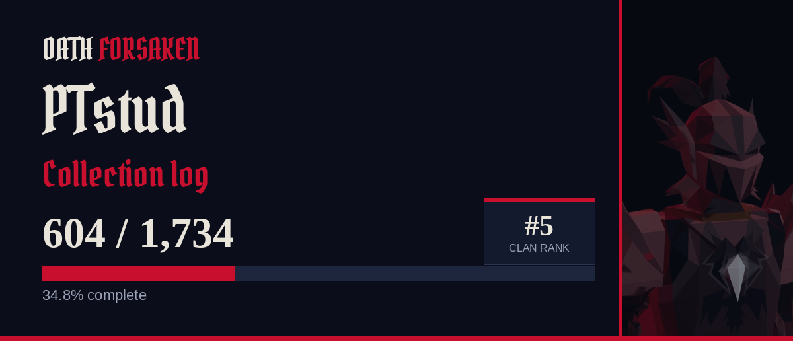

# Oath Forsaken Bot

Discord bot for Oath Forsaken, an Old School RuneScape clan.

It handles the server's routine work: application panels and review, tenure ranks, strikes, team finding, competition posts, bounties, and the profile and collection cards members use in chat. Member profiles also show on the clan website, oathforsaken.cc.

## What it does

- **Applications:** members apply through a panel, and staff approval sets their rank automatically
- **Ranks:** tenure roles from Initiate to Godslayer, assigned daily, plus a hand-picked top rank
- **Moderation:** three-strike system with a full audit log
- **Competitions:** Skill of the Week and Raid of the Week, from the poll to the winner role, tracked on Wise Old Man
- **Cards:** profile, collection log, boss and dry-streak cards, posted on request
- **Team finder:** posts and signups for group PvM
- **Bounties:** a rotating bounty board that members claim from

## Commands

Slash commands cover applications, strikes, competitions, cards, bounties and the team finder. Type `/` in the server to browse them.

Built with Node.js and discord.js.

## Join us

Applications run through the clan website: [oathforsaken.cc](https://oathforsaken.cc)

## About this repo

This repo is public so members can see how the bot works. It is written for Oath Forsaken's server and is not set up to run as-is elsewhere.
